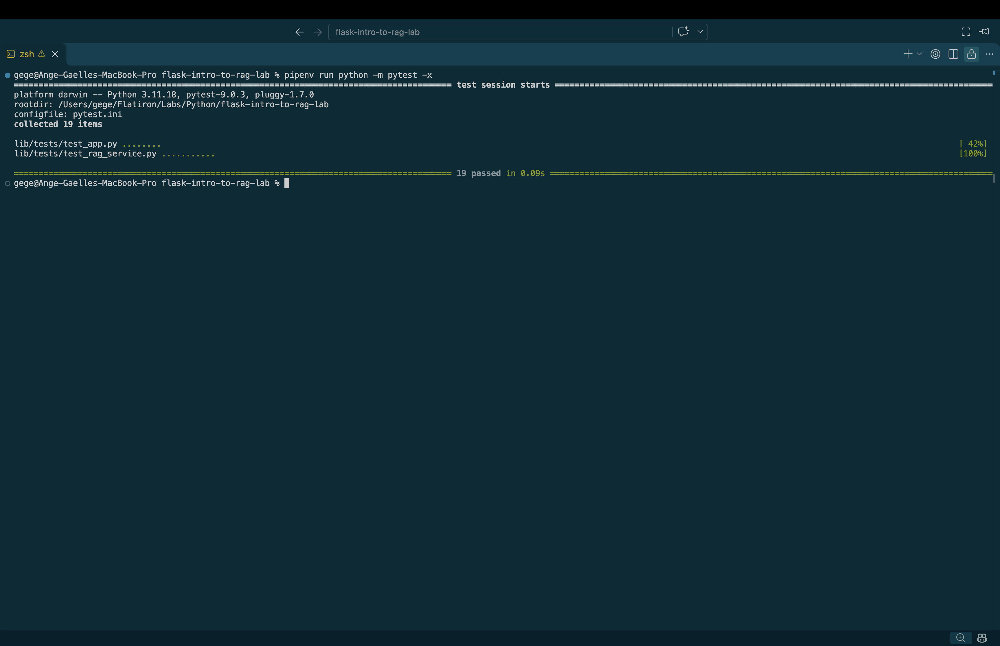

# Retrieval-Augmented Generation (RAG) with Flask

## Description

This project is a Flask API that uses Retrieval-Augmented Generation (RAG) to answer questions based on a collection of company documents.

Instead of relying only on an AI model's general knowledge, the application searches for relevant information in company documents and uses that information to build a structured prompt.

The prompt is then sent to an AI model through Ollama to generate a source-backed answer.

## Technologies Used

- Python 3.11
- Flask
- Ollama
- Llama 3.2
- Requests
- Pytest
- Pipenv

## Features

- Accepts user questions through a POST request.
- Validates incoming JSON requests.
- Tokenizes text and removes common stopwords.
- Searches company documents for matching keywords.
- Scores documents based on relevance.
- Gives additional weight to matching words in document titles.
- Retrieves the highest-scoring documents.
- Formats retrieved documents into structured context.
- Builds prompts that instruct the AI to use only the provided information.
- Returns AI-generated answers with source information.
- Provides a safe fallback when no relevant documents are found.
- Handles AI service errors with an HTTP 503 response.

## Project Structure

```text
flask-intro-to-rag-lab/
├── lib/
│   ├── ai_client.py
│   ├── app.py
│   ├── company_documents.py
│   ├── rag_service.py
│   └── tests/
├── Pipfile
├── Pipfile.lock
└── README.md
```

## Installation

### 1. Clone the repository

```bash
git clone git@github.com:a-gbatie/flask-intro-to-rag-lab.git
cd flask-intro-to-rag-lab
```

### 2. Install dependencies

Make sure Python 3.11 and Pipenv are installed.

```bash
pipenv install
```

### 3. Start Ollama

Make sure Ollama is installed and running, and that the Llama 3.2 model is available.

```bash
ollama pull llama3.2
```

### 4. Start the Flask application

```bash
pipenv run python -m flask --app lib.app run
```

The application runs at:

```text
http://127.0.0.1:5000
```

## API Endpoints

### GET /api/health

Checks whether the Flask application is running.

Example response:

```json
{
  "status": "ok"
}
```

### POST /api/ask

Accepts a question and returns an AI-generated answer based on relevant company documents.

Example request:

```bash
curl -X POST http://127.0.0.1:5000/api/ask \
  -H "Content-Type: application/json" \
  -d '{"query": "How do I request software access?"}'
```

Example response structure:

```json
{
  "query": "How do I request software access?",
  "answer": "An answer generated using the retrieved company documents.",
  "sources": [
    {
      "id": "document_id",
      "title": "Document Title"
    }
  ]
}
```

The actual answer and sources depend on the retrieved documents and AI response.

## How RAG Works

The application follows these steps:

1. **Receive a question:** Flask accepts a JSON request containing the user's query.
2. **Tokenize the question:** The query is converted into searchable lowercase tokens, excluding stopwords.
3. **Search documents:** The application compares the query tokens with company document content.
4. **Score documents:** Matching words contribute to a relevance score, with additional points for title matches.
5. **Retrieve context:** The highest-scoring documents that meet the minimum relevance threshold are selected.
6. **Build the prompt:** The selected documents and user's question are combined with instructions for the AI.
7. **Generate an answer:** Ollama processes the prompt using the Llama 3.2 model.
8. **Return the response:** Flask returns the question, generated answer, and document sources as JSON.

## RAG Service Functions

The `rag_service.py` file contains the following functions:

- `tokenize()` — Converts text into searchable tokens.
- `document_search_text()` — Combines searchable document fields.
- `score_document()` — Calculates a document's relevance to a query.
- `retrieve_context()` — Filters and ranks relevant documents.
- `format_context()` — Formats retrieved documents into readable context.
- `build_prompt()` — Creates the structured prompt for the AI.
- `source_metadata()` — Returns the ID and title of a source document.

## Error Handling

The application handles several scenarios:

**Invalid query — HTTP 400**

If the query is missing, empty, or not a string, the API returns an error.

**No relevant documents — HTTP 200**

If no documents meet the relevance threshold, the API returns a safe fallback message with an empty sources list.

**AI service unavailable — HTTP 503**

If the AI client raises a `RuntimeError`, the API returns a service-unavailable error.

## Testing

This project uses Pytest to verify the RAG service functions and Flask API behavior.

Run the tests using:

```bash
pipenv run python -m pytest
```

To stop at the first failing test:

```bash
pipenv run python -m pytest -x
```

All tests were passing upon completion of the lab.

## Screenshot of Completed Tests

